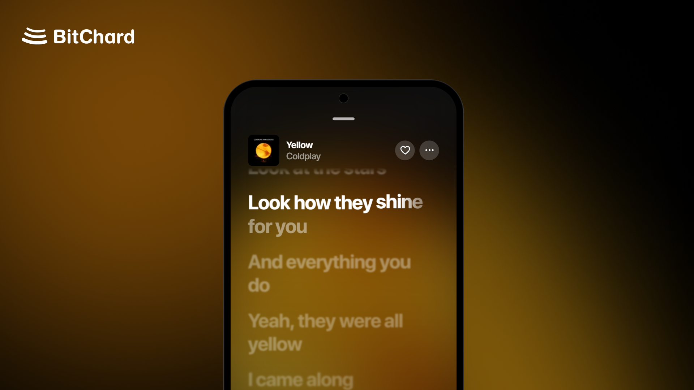
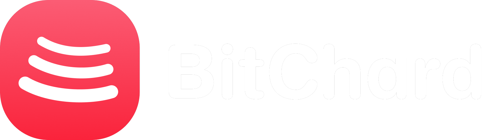

<div align="center">



<br/><br/>



# BitChard

### *The Ultimate, Aesthetic & AI-Powered YouTube Music Client*
**Ad-free • Lossless Audio • Word-Synced Lyrics • Smart AI DJ • Kotlin Multiplatform**

<br/>

[](https://github.com/SatanMerde/BitChard/releases)
[](https://github.com/SatanMerde/BitChard/blob/main/LICENSE)
[](https://github.com/SatanMerde/BitChard/releases)
[](https://kotlinlang.org/)
[](https://deepmind.google/technologies/gemini/)

<br/><br/>

[](https://github.com/SatanMerde/BitChard/issues/new?template=bug_report.yml)
[](https://github.com/SatanMerde/BitChard/issues/new?template=feature_request.yml)
[](https://discord.gg/pw9wNbDzMx)
[](https://github.com/SatanMerde/BitChard/discussions)

<br/><br/>

<a href="https://fmhy.net/mobile#youtube-music" target="_blank" rel="noopener noreferrer"></a>
<a href="https://trendshift.io/repositories/177639?utm_source=repository-badge&amp;utm_medium=badge&amp;utm_campaign=badge-repository-177639" target="_blank" rel="noopener noreferrer"></a>

<br/><br/>

[**✨ What's Unique**](#-whats-unique-in-bitchard) • [**🤖 BitG AI DJ**](#-bitg--the-interactive-ai-dj) • [**🎤 Synced Lyrics**](#-apple-music-style-synced-lyrics) • [**🎛️ Audio Engine**](#%EF%B8%8F-audiophile--lossless-sound-engine) • [**📦 Playlists & Spotify**](#-100-editable-playlists--1-click-spotify-sync) • [**💻 Desktop & Multiplatform**](#-native-desktop--multiplatform-experience) • [**⚡ Downloads**](#-downloads--releases) • [**💬 Feedback & Issues**](#-community-feedback--support) • [**🛠️ Building**](#%EF%B8%8F-building-from-source)

</div>

<br/>

> [!NOTE]
> **BitChard** is an independent, advanced, and modernized fork of BitChord, created and maintained by [SatanMerde](https://github.com/SatanMerde). Built to provide an uncompromising music experience: zero advertisements, zero tracking, audiophile-grade lossless sound, syllable-level Apple Music lyrics, and an interactive voice AI DJ powered by cutting-edge LLMs.

---

## 🌟 Core Features & Highlights

<div align="center">

<table>
  <tr>
    <td width="50%" valign="top">

### 🤖 BitG — Advanced AI DJ
- **Spotify DJ Architecture** : Curates structured dynamic batches (4–6 tracks), speaks natural commentary transitions between sets, and switches vibes instantly.
- **Real-Time Audio Ducking** : Automatically reduces music playback volume to 20% while BitG speaks, fading smoothly back to 100%.
- **Multi-LLM Intelligence** : Connects seamlessly to **Google Gemini 2.0 Flash**, **Claude 3.5 Sonnet**, OpenAI GPT-4o, or custom local endpoints.
- **Natural Language Voice & Text Prompts** : Ask for any vibe (*"energetic 80s synthwave for late-night coding"*, *"chill lo-fi hip hop"*) in French or English.
- **Musical DNA Analysis** : Analyzes your listening history, top artists, and starred favorites to curate bespoke track blocks.

    </td>
    <td width="50%" valign="top">

### 🎤 Apple Music-Style Synced Lyrics
- **Hypnotic Flow** : Word-by-word and syllable-by-syllable synchronized glowing lyrics with Apple Music-inspired fluid kinetic animations.
- **Multi-Source Precision Engine** : Integrates high-accuracy time-stamped sources including NetEase YRC, Musixmatch RichSync, LrcLib, and Genius.
- **Instant Lyrics Translation** : Translate foreign songs into your language with a single tap.
- **Immersive Visuals** : Dynamic frosted blur with Spotify Canvas & Apple Music Motion animated backgrounds.

    </td>
  </tr>
  <tr>
    <td width="50%" valign="top">

### 🎛️ Audiophile & Lossless Sound Engine
- **Hi-Res Lossless 24-bit / 96kHz** (FLAC / ALAC) with intelligent automatic fallback to official YouTube Music audio streams.
- **Bit-perfect USB Exclusive Output** : Sends lossless audio streams directly to a USB DAC unchanged, at each track's native sample rate and bit depth.
- **Harmonic Crossfade & Automix** : Fully customizable smooth crossfade with tempo and beat matching.
- **10-Band Parametric Equalizer** with 32-bit floating-point audio processing pipeline.
- **Smart Silence Trimming** & Customizable sleep timer (end of track or custom duration).

    </td>
    <td width="50%" valign="top">

### 📦 100% Editable Playlists & 1-Click Spotify Sync
- **Total Editing Freedom** : Rename playlists, reorder tracks via effortless drag-and-drop, and add or remove songs freely.
- **Device & Offline Playlists** : Create and manage local offline playlists directly on device without needing an account.
- **1-Click Spotify Batch Import** : Synchronize your entire Spotify library (all playlists and followed artists) into local storage or your YouTube Music account in one go.
- **High-Precision Matching Algorithm** : Eliminates wrong covers, low-quality karaoke versions, and unwanted live remixes.

    </td>
  </tr>
  <tr>
    <td width="50%" valign="top">

### 💻 Native Desktop & Multiplatform Experience
- **Windows** : Native **Mica & Acrylic** translucent backdrop with Windows Taskbar media thumbnail controls.
- **Linux** : Native **MPRIS2** protocol support, distributed as portable AppImage, DEB, and RPM packages.
- **macOS** : Sleek Cocoa frame integration with native media keys support.
- **Android TV & WearOS** : Dedicated interfaces built for large screens and smartwatch companion controls.

    </td>
    <td width="50%" valign="top">

### 🎨 Cyber & Material You Aesthetics
- **Frosted Glassmorphism & Haze Blur** : High-performance dynamic glass blur effects across sheets and player views.
- **Dynamic Material You Palette** : Application UI colors adapt in real time to the tones of the currently playing album artwork.
- **Collapsible Volume Bar** : Option in *Settings → Appearance* to completely hide the player volume row for an ultra-clean layout.
- **Stats for Nerds & Listen Together** : Codec, sample rate, bit depth, and party sync listening.

    </td>
  </tr>
  <tr>
    <td width="50%" valign="top">

### ✨ Spotify Smart Shuffle (« Lecture Intelligente »)
- **3-State Shuffle Cycle** : Cycle effortlessly through `OFF` → `ON` → `SMART SHUFFLE` ✨ from player controls.
- **Queue Context Weaving** : Seamlessly interleaves 1 handpicked contextual recommendation every 3 tracks without interrupting your listening flow.
- **Visual Sparkle Badges** : Recommended tracks stand out with an elegant `✨ Recommandé pour cette playlist` badge.
- **Zero Interruption Restoration** : Turning shuffle off smoothly strips recommendations and restores canonical track order.

    </td>
    <td width="50%" valign="top">

### 🛡️ AI Content & Vocal Generator Blocker
- **1-Click Filter in Settings** : Toggle on *Block AI-generated music* to purge synthetic songs from your musical world.
- **Universal Guardrails** : Automatically filters out Suno, Udio, AI covers, Diff-SVC, and RVC vocal clones from search results, home shelves, and playlists.
- **Automatic Playback Skip** : Instantly skips past any AI-generated song encountered in radio or autoplay.

    </td>
  </tr>
</table>

</div>

---

## ✨ What's Unique in BitChard

| Feature | BitChard | Original BitChord | Official YouTube Music |
|---|:---:|:---:|:---:|
| **Zero Ads & Full Background Playback** | ✅ **Yes (Free & Forever)** | ✅ Yes | ❌ Paid Subscription Required |
| **Interactive Voice AI DJ (Gemini 2.0 / Claude / BitG)** | ✅ **Yes (Spotify-style ducking & sets)** | ❌ No | ❌ No |
| **Spotify Smart Shuffle (« Lecture Intelligente »)** | ✅ **Yes (3-state cycle & weave)** | ❌ Standard only | ❌ No |
| **AI Music & Vocal Clone Blocker (Suno / Udio)** | ✅ **Yes (Full filter & skip)** | ❌ No | ❌ No |
| **Word & Syllable-Level Synced Lyrics (Apple Music Style)** | ✅ **Yes** | ✅ Yes | ⚠️ Basic (Line-by-line) |
| **24-bit Hi-Res Lossless FLAC / ALAC Streams** | ✅ **Yes** | ✅ Yes | ❌ 256kbps AAC Max |
| **100% Editable Imported Playlists (Reorder / Rename)** | ✅ **Yes (Full control)** | ❌ Read-only | ❌ No |
| **Enhanced 1-Click Spotify Batch Import** | ✅ **Yes (Custom matcher)** | ⚠️ Standard importer | ❌ No |
| **Maintained Desktop Releases (Win Mica / Linux / Mac)** | ✅ **Yes (Continuous builds)** | ⚠️ Unmaintained in v1.8.1 | ❌ Web Browser Only |
| **Customization (Collapsible Volume Bar, UI Tweaks)** | ✅ **Yes** | ❌ Fixed | ❌ Fixed |

---

## ⚡ Downloads & Releases

Pre-compiled and signed packages are available in the [**GitHub Releases**](https://github.com/SatanMerde/BitChard/releases) section:

<div align="center">

| Platform | Package / Asset | Details |
|---|---|---|
| **Android (Recommended)** | [`BitChard-arm64-v8a.apk`](https://github.com/SatanMerde/BitChard/releases) | Signed production APK for 64-bit Android smartphones (~65 MB) |
| **Android (Universal)** | [`BitChard-universal.apk`](https://github.com/SatanMerde/BitChard/releases) | Compatible with all Android architectures & emulators (~164 MB) |
| **Windows** | [`BitChard-windows-x64-setup.exe`](https://github.com/SatanMerde/BitChard/releases) / `.msi` | Windows installer with native Mica / Acrylic material |
| **Linux** | [`BitChard-linux-x86_64.AppImage`](https://github.com/SatanMerde/BitChard/releases) / `.deb` / `.rpm` | Standalone binary with MPRIS2 integration |
| **macOS** | [`BitChard-macos-arm64.dmg`](https://github.com/SatanMerde/BitChard/releases) | Disk image for Apple Silicon & Intel Macs |
| **WearOS** | [`BitChardWear-prod-release.apk`](https://github.com/SatanMerde/BitChard/releases) | Companion app for WearOS smartwatches |

</div>

---

## 🛠️ Building from Source

### Prerequisites
- **JDK 17** or higher (e.g., Eclipse Temurin 17 / 21)
- **Android SDK** (API 34/35 installed)
- **Git**

```bash
# 1. Clone the repository
git clone https://github.com/SatanMerde/BitChard.git
cd BitChard

# 2. Build the Android APK (Dev Debug)
./gradlew :app:assembleDevDebug

# 3. Build the Desktop application for your current OS
./gradlew :desktopApp:packageDistributionForCurrentOS
```

Compiled deliverables will be located at:
- Android: `app/build/outputs/apk/dev/debug/`
- Desktop: `desktopApp/build/compose/binaries/main/`

---

## 💬 Community, Feedback & Support

We welcome your feedback, ideas, and issue reports to keep making BitChard better every day!

<div align="center">

| 🐛 Found a Bug? | ✨ Want a Feature? | 💬 Have a Question? | 🎧 Discord Community |
|:---:|:---:|:---:|:---:|
| [**Open Bug Report**](https://github.com/SatanMerde/BitChard/issues/new?template=bug_report.yml) | [**Request Feature**](https://github.com/SatanMerde/BitChard/issues/new?template=feature_request.yml) | [**Join Discussions**](https://github.com/SatanMerde/BitChard/discussions) | [**Join Discord Server**](https://discord.gg/pw9wNbDzMx) |
| Detailed crash & device reproduction form | Propose improvements for BitG, UI, or Audio | Chat with the community & creator | Live support, beta drops & AI DJ prompts |

</div>

---

## 🔒 Privacy & Legal Disclaimer

- **Zero Tracking**: BitChard does not collect, log, or track your listening habits, personal data, or account details.
- **Private API Keys**: All AI provider keys (Gemini, Claude, OpenAI) remain encrypted and stored strictly on your local device.
- **License**: This project is distributed under the terms of the [GNU General Public License v3.0 (GPLv3)](LICENSE).
- **Disclaimer**: BitChard is an independent, non-commercial open-source project and is neither affiliated with nor endorsed by Google LLC, YouTube Music, or Spotify AB.

---

<div align="center">

<b>Created with passion by <a href="https://github.com/SatanMerde">SatanMerde 🇫🇷</a></b><br/>
*Built upon the foundation laid by Kushagra Singh and the open-source community.*

<br/>

<a href="#bitchard">▲ Back to top</a>

</div>
